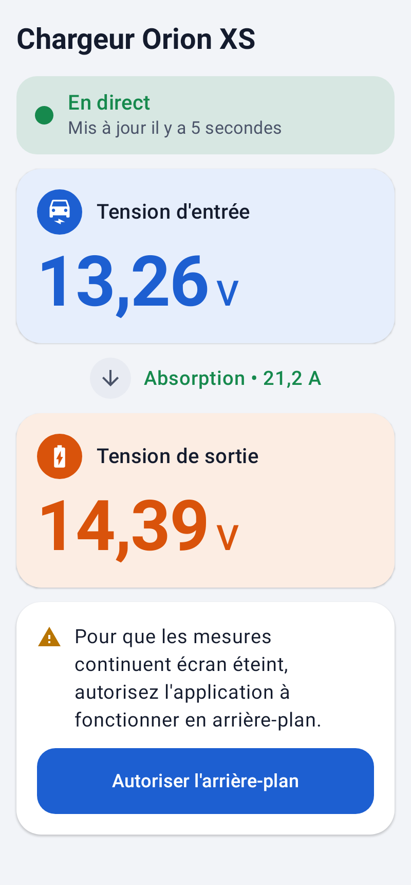
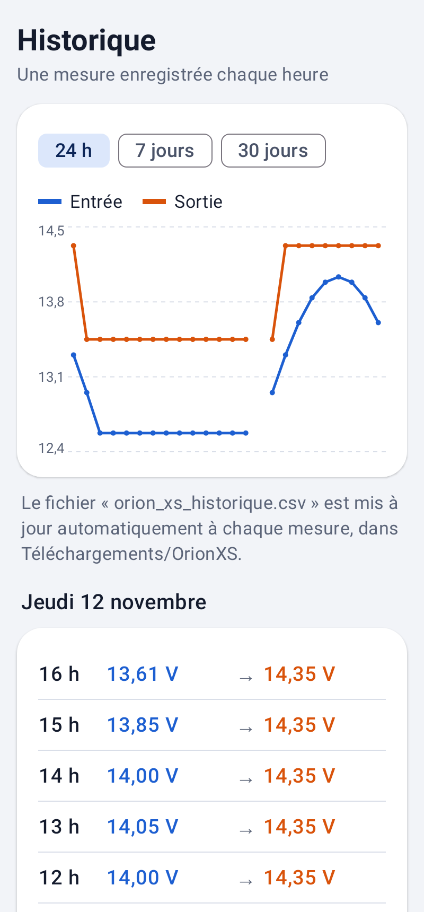
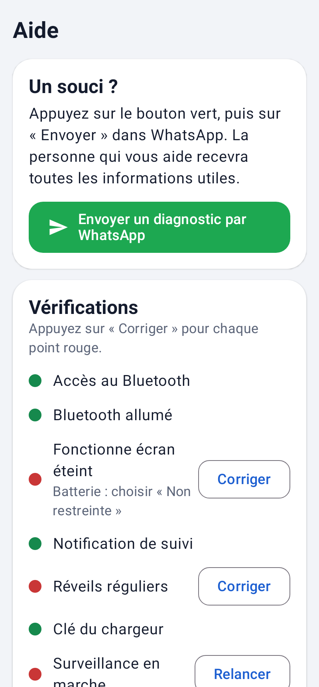

# Orion XS : suivi Bluetooth d'un chargeur Victron

Application Android (en français) qui lit en Bluetooth les annonces chiffrées « Instant Readout » d'un chargeur
DC-DC **Victron Orion XS**, affiche en direct la tension d'entrée et de sortie, et garde une mesure par heure.
Elle est conçue pour être simple : gros caractères, assistant en 3 étapes et bouton « diagnostic par WhatsApp » pour une assistance à distance.

| Direct | Historique | Aide |
|---|---|---|
|  |  |  |

## Fonctionnalités

- Décodage des annonces Victron (AES-128-CTR), inspiré de la bibliothèque open source
  [victron-ble](https://github.com/keshavdv/victron-ble). Gère l'Orion XS (enregistrement 0x0F) et l'Orion Smart DC-DC (0x04).
- Service de premier plan qui tourne en continu, même écran éteint. Il est pensé pour les téléphones Samsung :
  scan filtré, exemption de l'optimisation batterie, alarme exacte de surveillance et redémarrage automatique.
- Une mesure par heure, enregistrée en SQLite, avec une courbe sur 24 h, 7 jours ou 30 jours.
- Fichier `Téléchargements/OrionXS/orion_xs_historique.csv` mis à jour automatiquement (format Excel français).
- Diagnostic complet envoyé en un bouton par WhatsApp : état du système, appareils Victron captés et journal.

## Compiler

Prérequis : JDK 17 ou plus, Android SDK 35.

```bash
cp secrets.properties.example secrets.properties   # numéro WhatsApp de l'aidant (facultatif)
./gradlew test       # tests du décodeur et captures d'écran (Robolectric)
./gradlew livrer     # APK signé dans livraison/OrionXS-<version>.apk (nécessite keystore/)
```

Le keystore de signature, `secrets.properties` et les APK ne sont pas versionnés.
Voir [LISEZMOI-DEVELOPPEUR.md](LISEZMOI-DEVELOPPEUR.md) pour l'architecture, la lecture d'un diagnostic
et l'historique des versions.

## Structure

```
app/src/main/java/com/orionxs/suivi/
├── ble/       décodage Victron (VictronDecoder, libellés FR)
├── data/      historique SQLite, CSV, réglages, journal, vérifications système
├── service/   service d'arrière-plan, alarmes, démarrage, diagnostic
└── ui/        écrans Compose (assistant, direct, historique, aide)
```
